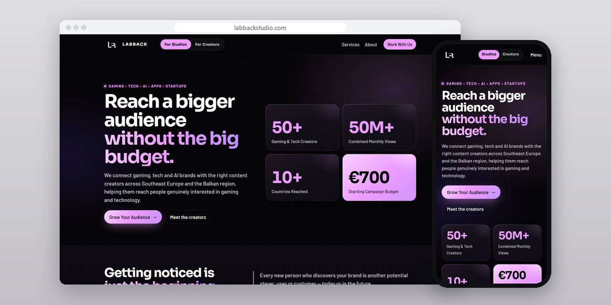
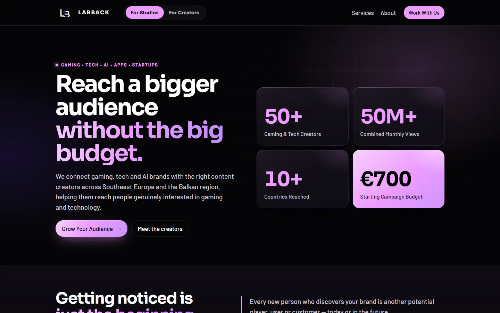
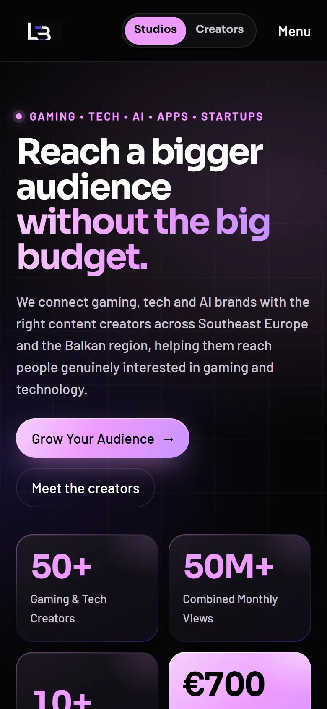
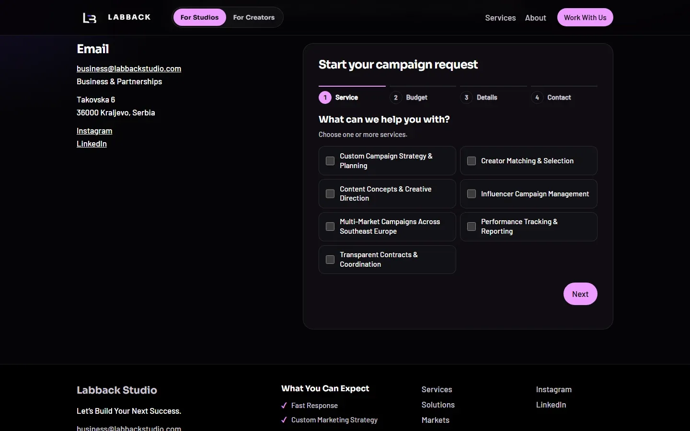
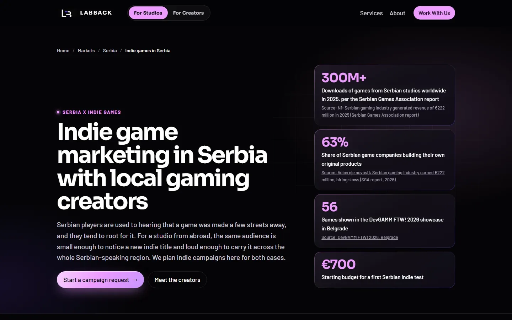

# Labback Studio

A site for a creator campaign agency from Kraljevo, with a switch between brands and creators and 101 market and product pages with sources.

**[labbackstudio.com](https://www.labbackstudio.com/)** · [Case study](https://svilenkovic.com/portfolio/labback-studio) · [Srpski](README.sr.md)

> [!NOTE]
> Client project. The source code belongs to the client and stays in a private repository. This page describes what I built and how.

<table>
  <tr><td><b>Client</b></td><td>Labback Studio</td></tr>
  <tr><td><b>Industry</b></td><td>Creator campaigns for gaming and tech brands</td></tr>
  <tr><td><b>Location</b></td><td>Kraljevo, Serbia</td></tr>
  <tr><td><b>Type</b></td><td>Multi-page agency website in English</td></tr>
  <tr><td><b>My role</b></td><td>Redesign, development, migration, SEO and hosting</td></tr>
  <tr><td><b>Stack</b></td><td>PHP 8.5, JavaScript, JSON, nginx, JSON-LD</td></tr>
</table>

## About the project

Labback Studio connects gaming, tech and app brands with content creators in Southeast Europe and the Balkans. Its earlier site was on Wix. The new one speaks to two audiences, brands looking for a campaign and creators who want to join the network, so the header has a “For Studios | For Creators” switch that works like a language picker.

Next to the home page and the fixed pages there are 101 pages in English: seven service pages, 34 pages by product type, 12 market pages and 48 guides that pair six markets with eight product types. Every figure on them has a link to its source right below it, and markets where the network has no creators of its own say that local creators are picked for each campaign. Before every release a script checks each page for text length, allowed HTML, links and phrases repeated across pages.

## What I built

- A switch between the studio and creator sides of the site, shortened to “Studios | Creators” next to the menu on phones
- A four-step inquiry form: services, budget, product and goal with a start date, then name and email
- A separate creator application that asks for channels, platform, audience size and topic
- 101 market, product and guide pages kept as JSON records, each guide with a table of contents, key dates and FAQ
- A dark design with a purple accent, a moving row of creator cards and a brand logo strip that stops on hover
- Redirects from the old Wix addresses, and analytics only after consent

## Results

| | Performance | Accessibility | Best practices | SEO |
| :-- | :-: | :-: | :-: | :-: |
| Mobile | 100 | 100 | 100 | 100 |
| Desktop | 100 | 100 | 100 | 100 |

PageSpeed Insights, lab test of the live site, November 2026. Security headers: 6 of 6. HTML validator: no errors. axe accessibility check: no violations. Structured data: `Organization`, `ProfessionalService`.

## Screenshots

<table>
  <tr>
    <td width="68%" valign="top"></td>
    <td width="32%" valign="top"></td>
  </tr>
</table>

Contact: a four-step inquiry, from choosing services to name and email

One of the 48 market and product guides: indie games in Serbia, with a source below every figure

---

Built by [D. Svilenković](https://svilenkovic.com).
