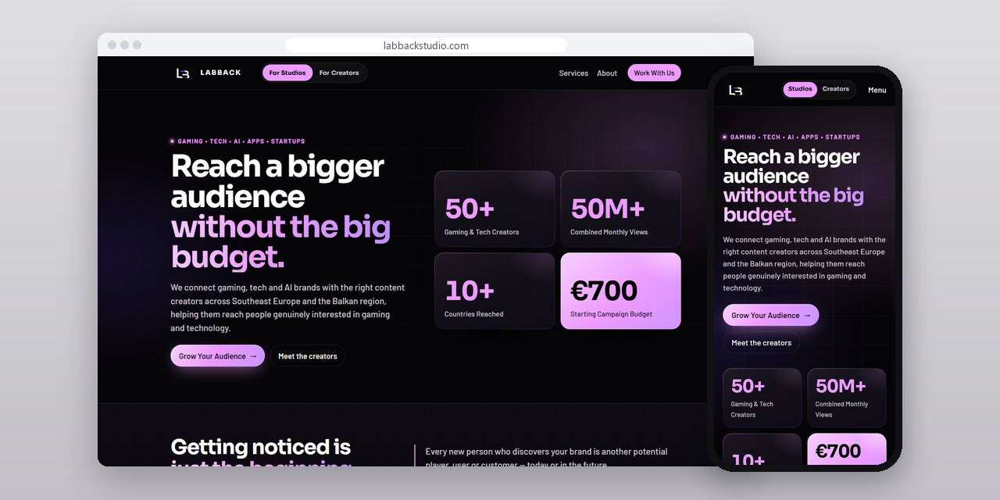
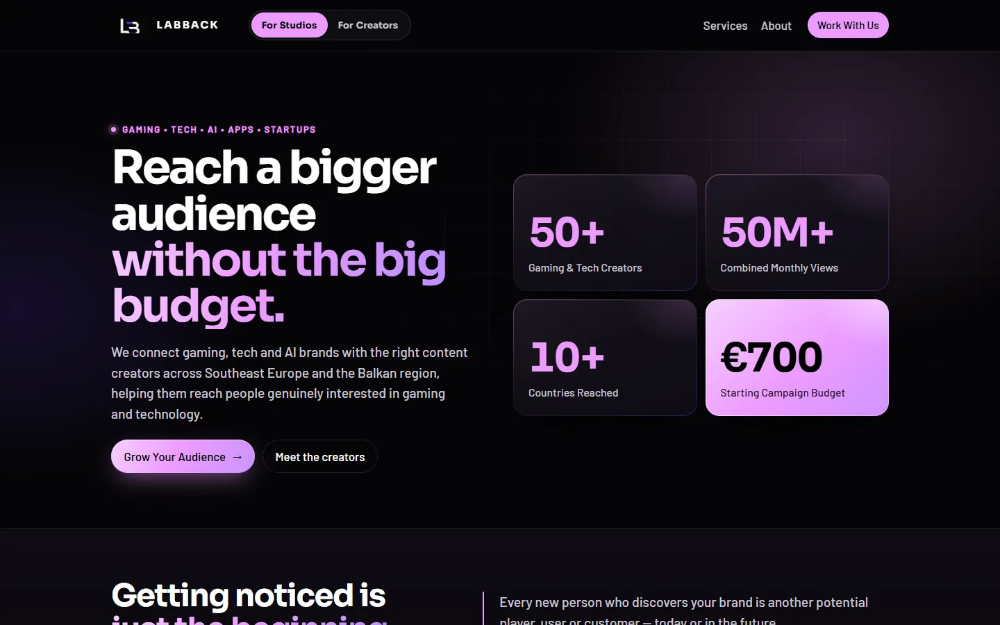
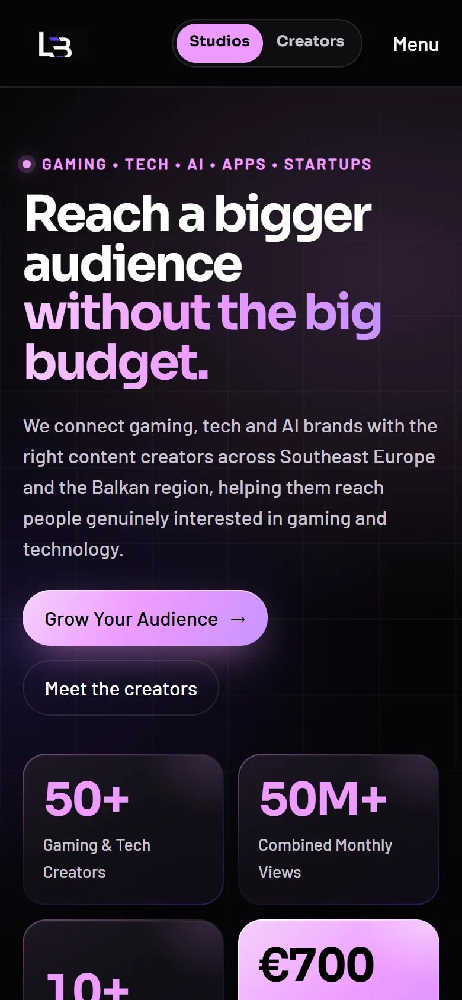
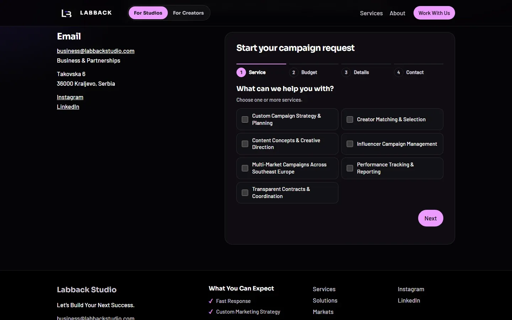
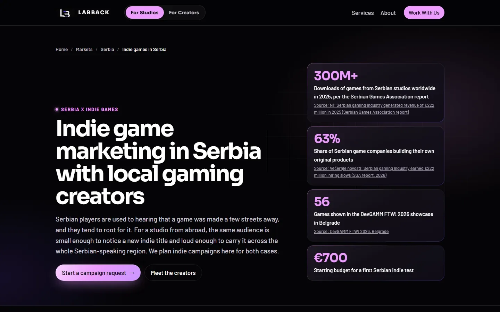

# Labback Studio

Sajt agencije za kampanje sa kreatorima iz Kraljeva, sa prekidačem za brendove i kreatore i 101 stranom o tržištima i proizvodima sa izvorima.

**[labbackstudio.com](https://www.labbackstudio.com/)** · [Studija slučaja](https://svilenkovic.rs/radovi/labback-studio) · [English](README.md)

> [!NOTE]
> Klijentski projekat. Izvorni kod pripada klijentu i čuva se u privatnom repozitorijumu. Ova stranica opisuje šta sam uradio i kako.

<table>
  <tr><td><b>Klijent</b></td><td>Labback Studio</td></tr>
  <tr><td><b>Delatnost</b></td><td>Kampanje sa gejming i tech kreatorima</td></tr>
  <tr><td><b>Lokacija</b></td><td>Kraljevo</td></tr>
  <tr><td><b>Vrsta</b></td><td>Sajt agencije sa više strana na engleskom</td></tr>
  <tr><td><b>Moj deo posla</b></td><td>Redizajn, izrada, selidba, SEO i hosting</td></tr>
  <tr><td><b>Tehnologije</b></td><td>PHP 8.5, JavaScript, JSON, nginx, JSON-LD</td></tr>
</table>

## O projektu

Labback Studio povezuje gejming, tech i aplikacijske brendove sa kreatorima sadržaja u jugoistočnoj Evropi i na Balkanu. Raniji sajt bio je na Wix-u. Novi govori dvema publikama, brendovima koji traže kampanju i kreatorima koji žele u mrežu, pa je u zaglavlju prekidač „For Studios | For Creators”, nalik biraču jezika.

Uz naslovnu i stalne strane, sajt ima 101 stranu na engleskom: sedam strana usluga, 34 strane po vrsti proizvoda, 12 strana tržišta i 48 vodiča koji spajaju šest tržišta sa osam vrsta proizvoda. Svaka brojka na tim stranama ima vezu na izvor odmah ispod, a za tržišta na kojima mreža nema svoje kreatore piše da se lokalni kreatori biraju po kampanji. Pre svake objave skripta proverava svaku stranu: dužinu teksta, dozvoljen HTML, veze i fraze koje se ponavljaju među stranama.

## Šta sam uradio

- Prekidač između strane za studije i strane za kreatore, na telefonu skraćen na „Studios | Creators” pored menija
- Forma za upit u četiri koraka: usluge, budžet, proizvod i cilj sa željenim početkom, pa ime i mejl
- Posebna prijava za kreatore koja pita za kanale, platformu, veličinu publike i temu
- 101 strana o tržištima, proizvodima i vodiči kao JSON zapisi, svaki vodič sa pregledom sadržaja, važnim datumima i čestim pitanjima
- Tamna podloga sa ljubičastim akcentom, traka kartica kreatora u pokretu i traka logoa brendova koja staje pod mišem
- Preusmerenja sa starih Wix adresa i analitika samo uz pristanak

## Merenja

| | Performanse | Pristupačnost | Dobre prakse | SEO |
| :-- | :-: | :-: | :-: | :-: |
| Telefon | 100 | 100 | 100 | 100 |
| Desktop | 100 | 100 | 100 | 100 |

PageSpeed Insights, laboratorijsko merenje živog sajta, novembar 2026. Sigurnosna zaglavlja: 6 od 6. HTML validator: bez grešaka. axe provera pristupačnosti: bez prekršaja. Strukturisani podaci: `Organization`, `ProfessionalService`.

## Snimci ekrana

<table>
  <tr>
    <td width="68%" valign="top"></td>
    <td width="32%" valign="top"></td>
  </tr>
</table>

Kontakt: upit u četiri koraka, od izbora usluga do imena i mejla

Jedan od 48 vodiča tržište i proizvod: indie igre u Srbiji, sa izvorom ispod svake brojke

---

Izrada: [D. Svilenković](https://svilenkovic.rs).
